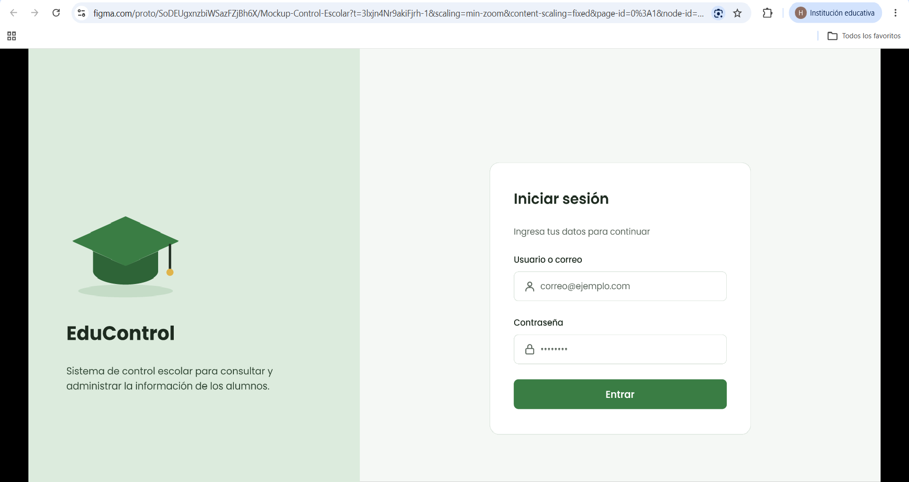
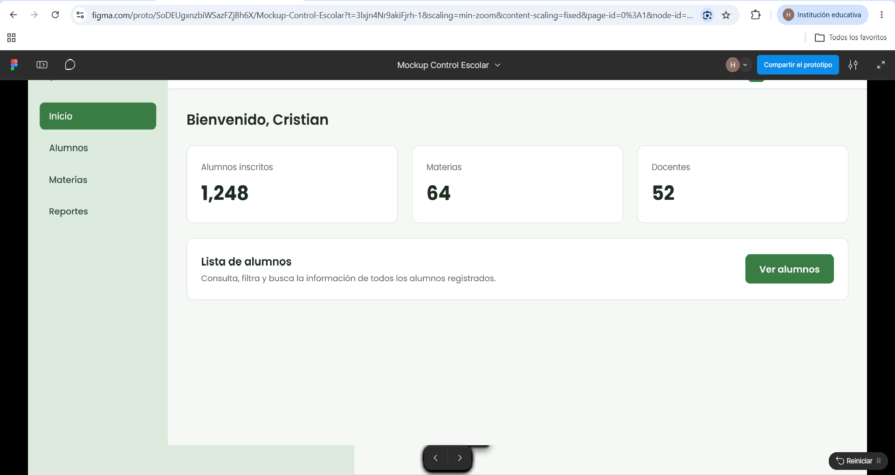

# t3_act8_eq10 — EduControl

Mini sistema web desarrollado en React (Vite) para la gestión escolar. Simula un flujo de autenticación real conectándose a la API REST de DummyJSON y ofrece un módulo completo de administración de alumnos con filtrado avanzado, paginación dinámica sincronizada en la URL mediante query parameters y operaciones CRUD (Create, Read, Update, Delete) respaldadas por estado local y peticiones HTTP.

---

## 👥 Integrantes (Equipo 10)

- **Martínez Pacheco Cristian**
- **Mendoza Lucero Hasiel Isai**

---

## 🚀 Enlace de Despliegue en Servidor

El proyecto se encuentra compilado y desplegado de manera pública en el servidor VPS:
👉 **[http://68.155.155.10/t3_act8_eq10/](http://68.155.155.10/t3_act8_eq10/)**

---

## 🎨 Diseños y Mockups de Figma

A continuación se presenta la propuesta visual diseñada previamente en Figma para la interfaz de la aplicación:

### 1. Pantalla de Autenticación (Login)


### 2. Pantalla de Bienvenida (Inicio)


### 3. Módulo de Lista de Alumnos (Tabla y Filtros)


---


## 🔌 Especificaciones de APIs Integradas

El sistema interactúa con los servicios RESTful proporcionados por **DummyJSON**:

### 1. Autenticación y Sesión
- **Endpoint:** `POST https://dummyjson.com/auth/login`
- **Payload:** `{ "username": "...", "password": "..." }`
- **Manejo de Respuestas:** Retorna el token JWT de sesión, así como el perfil público del usuario (nombre, apellido, email, avatar).

### 2. Módulo de Alumnos (DummyJSON Users)
Los usuarios de la API son adaptados dentro de la interfaz para representar la lista oficial de alumnos del sistema EduControl.
- **Consulta masiva (Listado):** `GET https://dummyjson.com/users?limit=0`
- **Registro de Alumno:** `POST https://dummyjson.com/users/add`
- **Edición de Registro:** `PUT https://dummyjson.com/users/{id}`
- **Eliminación de Registro:** `DELETE https://dummyjson.com/users/{id}`

> **Nota técnica sobre persistencia:** Dado que DummyJSON es un servicio API mock que simula operaciones de escritura, cada petición responde con el objeto modificado de manera exitosa, pero las variaciones se sincronizan en el estado reactivo (`useState`) para mantener la coherencia dentro de la experiencia de usuario.

---

## 🔑 Credenciales de Acceso para Pruebas

Para validar el módulo de inicio de sesión y la protección de rutas, se pueden utilizar los siguientes usuarios activos:

| Usuario | Contraseña | Rol / Perfil de Prueba |
| :--- | :--- | :--- |
| `emilys` | `emilyspass` | Administrador General |


*Nota: La interfaz permite también la autenticación utilizando el correo electrónico asociado al usuario.*

---

## ✨ Características Principales y Funcionalidades

### 🛡️ Autenticación y Seguridad
- Formulario de login con validación reactiva de campos obligatorios.
- Mensajes visuales para la gestión de errores de red o credenciales incorrectas.
- Rutas protegidas: el acceso directo a los módulos internos está restringido mientras no se detecte un token o sesión activa.

### 📐 Maquetación y Layout Reutilizable
- **Sidebar Dinámico:** Menú de navegación con accesos rápidos a Inicio, Alumnos, Materias y Reportes.
- **Navbar Superior:** Muestra la información del usuario autenticado (fotografía de perfil, nombre) e incluye la acción de cierre de sesión (*Logout*).

### 📊 Módulo de Alumnos y Data Table
- **Búsqueda global:** Filtrado en tiempo real por nombre completo o correo.
- **Filtro por género:** Segmentación instantánea de los datos.
- **Paginación configurable:** Selección de densidad de datos (10, 20, 40 o 50 registros por página).
- **Sincronización en URL:** Los parámetros `view`, `page`, `limit` y los filtros aplicados se reflejan en la barra de direcciones (`?view=alumnos&page=2&limit=20`), lo que permite compartir enlaces con búsquedas específicas y navegar mediante los botones de avance/retroceso del navegador.

### ✏️ Operaciones CRUD
- Modal de alta para nuevos estudiantes.
- Edición de campos existentes con modales de confirmación para prevenir cambios accidentales.
- Borrado de registros mediante diálogos de confirmación interactivos.
- Indicadores visuales de estado (*Loading spinners*) e interfaces de recuperación ante fallas de red.

---

## 📁 Estructura del Proyecto

```
src/
├── api/                  # Clientes HTTP y servicios REST
│   ├── authService.js    # Peticiones de inicio de sesión y token
│   ├── httpClient.js     # Configuración central de Fetch/Axios
│   └── studentsService.js# Métodos para operaciones CRUD de alumnos
├── components/           # Componentes modulares y reutilizables
│   ├── Layout/           # Sidebar, Navbar y contenedores principales
│   ├── Login/            # Formulario de credenciales y mensajes
│   ├── Modal/            # Modales universales y diálogos de confirmación
│   ├── Students/         # Formularios de alta/edición de alumnos
│   └── Table/            # Componentes de tabla, filtros y paginador
├── constants/            # Constantes de configuración global
├── hooks/                # Custom Hooks para lógica de estado y URL
│   ├── useStudents.js    # Custom hook para el estado del CRUD de alumnos
│   └── useUrlParams.js   # Sincronización de filtros y paginación en URL
└── pages/                # Vistas principales del sistema
├── Dashboard.jsx     # Contenedor principal de la aplicación
├── HomePage.jsx      # Pantalla de bienvenida
├── PlaceholderPage.jsx# Vistas secundarias en desarrollo
└── StudentsPage.jsx  # Vista principal del módulo de alumnos
```


## Ejecutar en local

```bash
npm install
npm run dev
```

## Despliegue en el VPS

```bash
npm run build
scp -r dist/* azureuser@68.155.155.10:/var/www/html/t3_act8_eq10/
```

El `base` de `vite.config.js` ya está configurado como `/t3_act8_eq10/`.
